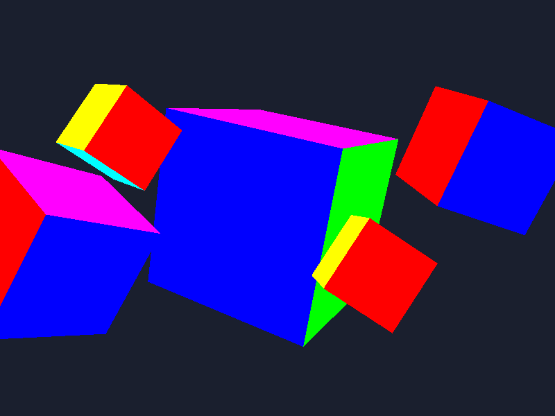
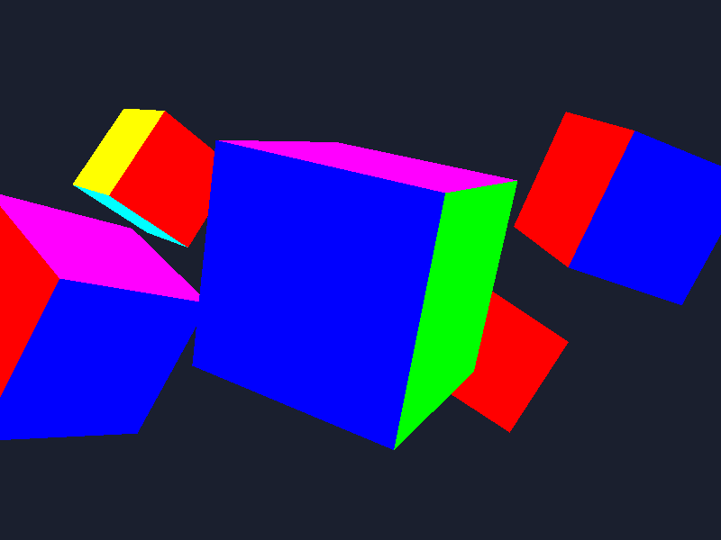

# 8-апта: тереңдік буфері, back-face culling, Z-fighting

Файл: `main.cpp`. Құрастыру: `cmake --build build && ./build/bin/cg`

## Не жасалды

| Бөлім | Іске асуы |
|---|---|
| Тереңдік тесті | `glEnable(GL_DEPTH_TEST)` — циклге дейін, бір рет |
| Буферді тазалау | `glClear(GL_COLOR_BUFFER_BIT \| GL_DEPTH_BUFFER_BIT)` — әр кадрда |
| Culling | `glEnable(GL_CULL_FACE)`, `glCullFace(GL_BACK)`, `glFrontFace(GL_CCW)` — циклге дейін |
| Бес куб | `positions[5]`, `model` цикл **ішінде** жарияланады, projection/view кадрда бір рет |
| Тереңдік буфері | `GLFW_DEPTH_BITS = 24`, іске қосқанда `depth bits: 24` шығады |
| 1-тапсырма | `D` — тереңдік тестін өшіру/қосу |
| 2-тапсырма | `2`-сахна: Z-fighting, `N` — near 0.0001 ↔ 0.1, `R` — far 1000 ↔ 100 |
| 3-тапсырма | `C` — `GL_BACK` ↔ `GL_FRONT`, `K` — culling өшіру/қосу |
| Қосымша | `G` — glDepthFunc, `3` — он куб, `TAB` — wireframe, `Q` — жазық төртбұрыш, `V` — gl_FragCoord.z |

## 1-тапсырма: тереңдік тесінсіз және тесімен

| Тесінсіз (`glEnable(GL_DEPTH_TEST)` өшірулі) | Тесімен |
|---|---|
|  |  |

Скриншоттар 800×600 өлшемде, `angle = 2.3` кезінде түсірілді.

- **Тесінсіз:** кубтар бір-бірін дұрыс жаппайды. Оң жақтағы кішкентай қызыл куб (#3, z = −3.5) ортадағы жақын кубтың (#0, z = 0) **үстінде** тұр.
- **Тесімен:** #3 куб жақын кубтың артында қалады, бәрі дұрыс.

Culling қосулы болғандықтан, әр кубтың артқы қырлары тесінсіз де сызылмайды. Сондықтан бір кубтың ішінде қате болмайды, қате тек кубтар бір-бірін жапқанда көрінеді. Culling-ті де өшірсең (`K`), 7-аптадағы «ішінен тысқа айналған» кубтар қайта шығады: [depth_off_nocull.png](docs/week08/depth_off_nocull.png).

### Қорғауға жауаптар

- **Тесінсіз нұсқада қай куб алда көрінеді?** Ең **соңғы сызылғаны**, яғни циклдегі индексі үлкені (#3, #4). Ол камерадан ең алыс болса да солай.
- **Неге дәл сол?** Тереңдік тесті болмаса, фрагментті салыстыратын ештеңе жоқ. Әр жаңа фрагмент түс буферіндегі бұрынғы түстің үстіне жай жазыла береді. Демек, экранда «кім кейін сызылды, сол алда» деген ереже жұмыс істейді.
- **Сызу ретін өзгертсең, нәтиже өзгере ме?** Тесінсіз — **иә**, қай куб алда шығатыны ауысады. Тесімен — **жоқ**, әр пиксельде z ең кіші фрагмент қалады, сызу реті маңызды емес.

## 2-тапсырма: Z-fighting

Сахна (`2` пернесі): екі куб бетпе-бет тұр, көк кубтың алдыңғы беті қызғылт кубтыкінен небәрі **0.001**-ге алда. Көк кубтың xy өлшемі сәл кішірек (0.7), сондықтан тек алдыңғы беттер таласады. Камера баяу тербеледі.

Көк беттің ішінде қызғылт болып кеткен пиксельдер үлесі (дұрысы 0%, камераның 4 түрлі орнында өлшенді):

| near | far | Жыпылықтау |
|---|---|---|
| 0.0001 | 1000 | 0% · 57% · 39% · 50% — **қатты жыпылықтайды** |
| 0.0001 | 100 | 0% · 42% · 14% · 65% — **әлі жыпылықтайды** |
| 0.001 | 1000 | 0% · 0% · 0% · 0% |
| **0.1** | **1000** | **0% · 0% · 0% · 0% — жыпылықтау жоқ** |

- **Жасау:** near = 0.0001 кезінде беттер жыпылықтайды, ал өрнегі камера қозғалғанда өзгереді.
- **Жою:** near = 0.1 болғанда жыпылықтау толық жоғалды.

### Қорғауға жауаптар

- **far-ды 1000-нан 100-ге түсірсең, жыпылықтау азая ма?** Жоқ, кестеде көрініп тұр: 100-де де жыпылықтайды.
- **Неге «far-ды кішірейту көмектеспейді»?** Перспективада тереңдік `1/z` бойынша сақталады. Камерадан `d` қашықтықтағы тереңдік қадамы шамамен `d² / (near · 2^24)` болады, яғни ол **near-ға** тәуелді, ал far-ға іс жүзінде тәуелді емес (far ≫ near кезінде).
  - Буфердің жартысы near мен 2·near аралығына жұмсалады.
  - near = 0.0001 кезінде бұл 0.0001…0.0002 аралығы, ал кубқа (d ≈ 2.5) қалғаны аз тиеді: қадам ≈ 6.25 / (0.0001 · 16.7 млн) ≈ **0.0037**. Бұл 0.001 айырмадан үлкен, сондықтан беттер таласады.
  - near = 0.1 кезінде қадам ≈ **0.0000037**, ал 0.001 айырма оңай ажыратылады.

## 3-тапсырма: culling тексеру

**Табылған қате.** 7-аптадағы массивтің үш қыры **сағат тілімен (CW)** жазылған екен: **артқы (қызыл), оң (сары), үстіңгі (күлгін)**. Ол кезде culling болмағандықтан, бұл байқалмады.

- `GL_BACK` кезінде бұл үш қыр жоғалады, кубта «тесік» пайда болады.
- `GL_FRONT` кезінде керісінше: тек осы үш қыр көрінеді, қалғаны жоғалады. Диагноз расталды.
- **Түзету:** осы үш қырдың әр үшбұрышындағы вершина ретін кері айналдырдым. Енді алты қырдың бәрі сыртынан қарағанда CCW. Әр үшбұрыштың нормалін (кросс-көбейтінді) сыртқа бағытпен салыстырып тексердім.
- `GL_BACK` кезінде кубтың алты қыры да көрінеді ✅

### Қорғауға жауаптар

- **Culling қосылғанда неше үшбұрыш растрланбай қалды?**
  - Бір кубта 12 үшбұрыш бар. Экранда бір уақытта ең көбі 3 қыр көрінеді, сондықтан әр кубтан **кемінде 6** үшбұрыш тасталады. Куб камераға тура қараса, бір ғана қыр көрінеді, сонда 10 үшбұрыш тасталады.
  - Бес кубтың 60 үшбұрышының `angle = 1.0` кезінде **36-сы** тасталды.
  - Яғни фрагмент шейдердің жұмысы жартыдан артық азаяды.
- **Куб айналғанда «артқы» қыр қалай ауысады, код өзгере ме?** Код өзгермейді. Үшбұрыштың алды-арты әр кадрда, проекциядан **кейін экранда** анықталады: вершиналар экранда сағат тіліне қарсы жүрсе — алды, сағат тілімен жүрсе — арты. Куб бұрылғанда қырдың экрандағы бейнесі «айналып», реті CCW-дан CW-ға ауысады, сонда ол өзі артқы қырға айналады.

## Қосымша

| Не | Нәтиже |
|---|---|
| `glDepthFunc(GL_LESS)` | Қалыпты: жақын фрагмент жеңеді (экранның 39.6%-ы боялды) |
| `glDepthFunc(GL_GREATER)` | **Экран бос (0%)**: буфер 1.0-мен тазаланады, ал ешбір фрагменттің тереңдігі 1.0-ден үлкен емес |
| `glDepthFunc(GL_ALWAYS)` | Тест әрқашан өтеді, тереңдік тесті өшірулі сияқты: соңғы сызылған алда (39.6%) |
| Он куб (`3`) | Шеңбер бойымен, радиусы 3, әрқайсысы әртүрлі жылдамдықпен айналады |
| Wireframe + culling (`TAB`) | Тек алдыңғы қырлардың сызықтары көрінеді. Culling растрлаудан бұрын, үшбұрыш деңгейінде жұмыс істейді, ал polygon mode оған әсер етпейді |
| Жазық төртбұрыш (`Q`) | Айналғанда жартылай уақыт жоғалады: оның бір ғана беті бар, оған арқасымен қарасаң, үшбұрыштар CW болып, culling оны тастайды |
| `gl_FragCoord.z` (`V`) | Барлық куб ақшыл-ақ болып көрінеді: near = 0.1 кезінде тереңдік мәндерінің көбі 1.0-ге жақын (`1/z` таралуы, біркелкі емес) |
